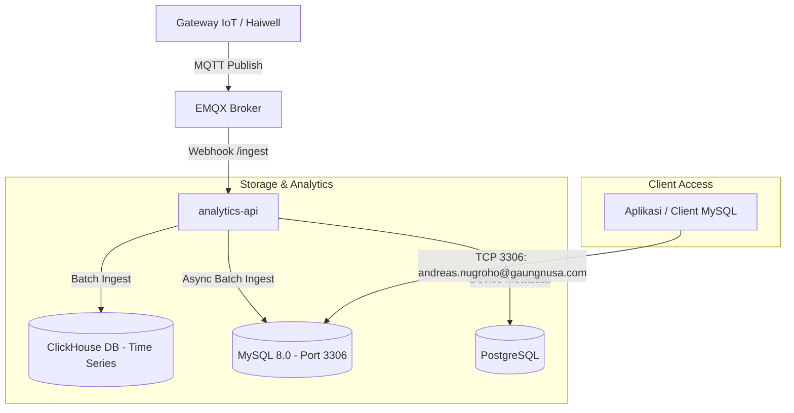

# Client MySQL 3306 Ingestion & External Access Implementation Plan

> **For agentic workers:** REQUIRED SUB-SKILL: Use superpowers:subagent-driven-development to implement this plan task-by-task. Steps use checkbox (`- [ ]`) syntax for tracking.

**Goal:** Menyediakan service MySQL di port `3306` pada VPS dengan database `iiot`, kredensial user `andreas.nugroho@gaungnusa.com` (password `Password123456`), dan tabel flat `telemetry` yang menerima duplikasi data telemetri real-time dari `analytics-api` saat gateway mem-publish data.

**Architecture:**
Aplikasi menambahkan container `mysql` (MySQL 8.0) di Docker network `iiot-net` dengan port `3306:3306` diekspos ke host VPS. Skrip inisialisasi otomatis membuat database `iiot`, user `andreas.nugroho@gaungnusa.com` dengan password `Password123456`, serta tabel flat `telemetry` (kolom: `ts`, `device_id`, `voltage`, `current`, `power`, `energy`, `temperature`, serta `raw_payload` JSON untuk fleksibilitas perubahan metrik). Service `analytics-api` diperluas dengan asynchronous buffer MySQL (`AsyncMySQLBatchBuffer`) yang bekerja berdampingan dengan buffer ClickHouse, memastikan setiap telemetri yang di-ingest dari gateway otomatis di-insert ke MySQL secara real-time dan andal.

**Architecture Diagram:**



**Tech Stack:**
- **Database:** MySQL 8.0 (Docker alpine/debian)
- **Backend Ingestion:** Python 3.11, FastAPI, `aiomysql` / `asyncmy` / `PyMySQL`
- **Orchestration:** Docker Compose (`docker-compose.yml`, `docker-compose.prod.yml`)

**Spec:** Kebutuhan akses remote klien MySQL port 3306 via IP VPS, user `andreas.nugroho@gaungnusa.com`, password `Password123456`, tabel flat telemetri (`timestamp`, `device_id`, `voltage`, `current`, `power`, dll).

## Global Constraints
- **Zero Breaking Changes**: Alur ClickHouse eksisting dan endpoint `/ingest` tidak boleh terganggu atau mengalami degradasi performa bila MySQL mengalami keterlambatan flush (buffer harus non-blocking / asynchronous).
- **Security & User Isolation**: User `andreas.nugroho@gaungnusa.com` hanya memiliki hak akses `SELECT, INSERT, UPDATE` pada database `iiot`, tanpa akses ke tabel sistem MySQL (`mysql.*`).
- **Flexible Schema**: Tabel flat MySQL memiliki kolom metrik utama numerik (`voltage`, `current`, `power`, `energy`, `temperature`) sekaligus kolom `raw_payload` (JSON) agar perubahan metrik dari klien di masa depan tetap tersimpan utuh tanpa perlu migrasi DDL mendadak.

---

### Task 1: Konfigurasi Service MySQL & Skrip Inisialisasi Database

**Files:**
- Create: `services/mysql/init/001-init-client-db.sql`
- Modify: `docker-compose.yml`
- Modify: `docker-compose.prod.yml`
- Modify: `.env.example`
- Modify: `.env`

**Interfaces:**
- Produces: Service MySQL berjalan di port `3306`, database `iiot` siap digunakan, user `andreas.nugroho@gaungnusa.com` memiliki hak akses dari host `%`.

- [ ] **Step 1: Buat skrip SQL inisialisasi MySQL**
Lokasi: `services/mysql/init/001-init-client-db.sql`

```sql
-- Inisialisasi Database iiot untuk Klien
CREATE DATABASE IF NOT EXISTS iiot CHARACTER SET utf8mb4 COLLATE utf8mb4_unicode_ci;
USE iiot;

-- Buat user klien dengan izin akses remote dari host '%'
CREATE USER IF NOT EXISTS 'andreas.nugroho@gaungnusa.com'@'%' IDENTIFIED BY 'Password123456';
GRANT SELECT, INSERT, UPDATE, CREATE, INDEX ON iiot.* TO 'andreas.nugroho@gaungnusa.com'@'%';
FLUSH PRIVILEGES;

-- Skema flat table telemetry
CREATE TABLE IF NOT EXISTS telemetry (
    id BIGINT AUTO_INCREMENT PRIMARY KEY,
    ts DATETIME(3) NOT NULL,
    device_id VARCHAR(64) NOT NULL,
    tenant_slug VARCHAR(64) NULL,
    site_slug VARCHAR(64) NULL,
    voltage DOUBLE NULL,
    current DOUBLE NULL,
    power DOUBLE NULL,
    energy DOUBLE NULL,
    frequency DOUBLE NULL,
    power_factor DOUBLE NULL,
    temperature DOUBLE NULL,
    raw_payload JSON NULL,
    created_at TIMESTAMP DEFAULT CURRENT_TIMESTAMP,
    INDEX idx_ts (ts),
    INDEX idx_device_ts (device_id, ts)
) ENGINE=InnoDB DEFAULT CHARSET=utf8mb4 COLLATE=utf8mb4_unicode_ci;
```

- [ ] **Step 2: Daftarkan volume dan service mysql di `docker-compose.yml` & `docker-compose.prod.yml`**
Tambahkan `mysql-data` di volumes dan definisi service `mysql`:

```yaml
  mysql:
    image: mysql:8.0
    container_name: iiot-mysql
    restart: unless-stopped
    command: --default-authentication-plugin=mysql_native_password
    environment:
      MYSQL_ROOT_PASSWORD: ${MYSQL_ROOT_PASSWORD:-change_me_mysql_root}
      MYSQL_DATABASE: ${MYSQL_DATABASE:-iiot}
    ports:
      - "3306:3306"
    volumes:
      - mysql-data:/var/lib/mysql
      - ./services/mysql/init:/docker-entrypoint-initdb.d
    networks:
      - iiot-net
    healthcheck:
      test: ["CMD", "mysqladmin", "ping", "-h", "127.0.0.1", "-u", "root", "-p${MYSQL_ROOT_PASSWORD:-change_me_mysql_root}"]
      interval: 10s
      timeout: 5s
      retries: 5
      start_period: 20s
```

- [ ] **Step 3: Tambahkan variabel env MySQL ke `.env` & `.env.example`**
```env
# === MySQL Client Database ===
MYSQL_PORT=3306
MYSQL_ROOT_PASSWORD=change_me_mysql_root
MYSQL_DATABASE=iiot
MYSQL_CLIENT_USER=andreas.nugroho@gaungnusa.com
MYSQL_CLIENT_PASSWORD=Password123456
```

- [ ] **Step 4: Commit konfigurasi dasar MySQL**
```bash
git add services/mysql/ docker-compose.yml docker-compose.prod.yml .env.example
git commit -m "feat(infra): add MySQL 8.0 service and client telemetry schema"
```

---

### Task 2: Modul Sink Telemetri MySQL di `analytics-api`

**Files:**
- Modify: `services/analytics-api/requirements.txt`
- Modify: `services/analytics-api/app/config.py`
- Create: `services/analytics-api/app/mysql_buffer.py`
- Test: `services/analytics-api/tests/test_mysql_buffer.py`

**Interfaces:**
- Consumes: Rekord telemetri yang telah diparse di `ingest_logic.py`.
- Produces: Asynchronous batch insert ke tabel `telemetry` di MySQL tanpa memblokir ClickHouse ingestion.

- [ ] **Step 1: Tambahkan `pymysql` dan `cryptography` ke requirements**
Tambahkan di `services/analytics-api/requirements.txt`:
```txt
pymysql>=1.1.0
cryptography>=42.0.0
```

- [ ] **Step 2: Tambahkan konfigurasi MySQL di `config.py`**
Di `services/analytics-api/app/config.py`:
```python
    mysql_host: str = "mysql"
    mysql_port: int = 3306
    mysql_db: str = "iiot"
    mysql_user: str = "andreas.nugroho@gaungnusa.com"
    mysql_password: str = "Password123456"
    mysql_enabled: bool = True
```

- [ ] **Step 3: Buat konektor & batch buffer MySQL di `mysql_buffer.py`**
Normalisasi field `voltage`, `current`, `power`, `energy`, `temperature` dari berbagai variasi alias (`v_pv`, `Voltage`, `p_pv`, `Power`, dsb) dan simpan `raw_payload` utuh.

- [ ] **Step 4: Tulis unit test untuk verifikasi normalisasi record flat MySQL**
Buat unit test di `services/analytics-api/tests/test_mysql_buffer.py` untuk menguji pemetaan metrik ke kolom flat tabel MySQL.

- [ ] **Step 5: Verifikasi unit test lulus**
```bash
pytest services/analytics-api/tests/test_mysql_buffer.py -v
```

- [ ] **Step 6: Commit sink telemetri MySQL**
```bash
git add services/analytics-api/
git commit -m "feat(analytics-api): implement async MySQL batch sink for flat telemetry table"
```

---

### Task 3: Integrasi Dual-Write di Pipeline `/ingest` & Lifecycle Startup

**Files:**
- Modify: `services/analytics-api/app/main.py`
- Modify: `services/analytics-api/app/routers/ingest.py`
- Test: `services/analytics-api/tests/test_ingest_mysql.py`

**Interfaces:**
- Consumes: Request HTTP `/ingest` dari EMQX Rule Engine.
- Produces: Telemetri serentak mengalir ke ClickHouse buffer dan MySQL buffer.

- [ ] **Step 1: Tulis integration test dual-write di `test_ingest_mysql.py`**
- [ ] **Step 2: Update `main.py` untuk lifecycle startup & shutdown MySQL buffer task**
- [ ] **Step 3: Update `ingest.py` untuk meneruskan parsed records ke MySQL buffer**
- [ ] **Step 4: Jalankan full suite test `analytics-api`**
```bash
pytest services/analytics-api/ -v
```
- [ ] **Step 5: Commit integrasi pipeline**
```bash
git add services/analytics-api/
git commit -m "feat(analytics-api): integrate MySQL dual-write into ingestion pipeline"
```

---

### Task 4: Dokumentasi Panduan Deployment & Firewall VPS

**Files:**
- Modify: `docs/vps-deployment.md`

- [ ] **Step 1: Update panduan firewall UFW di VPS**
Tambahkan panduan membuka port 3306 untuk klien:
```bash
sudo ufw allow 3306/tcp comment "MySQL Remote Access for Client"
```
Dan cara memverifikasi koneksi klien dengan:
```bash
mysql -h <IP_VPS> -P 3306 -u andreas.nugroho@gaungnusa.com -pPassword123456 iiot -e "SELECT * FROM telemetry LIMIT 5;"
```

- [ ] **Step 2: Commit dokumentasi**
```bash
git add docs/vps-deployment.md
git commit -m "docs: add MySQL port 3306 remote access setup to VPS deployment guide"
```
