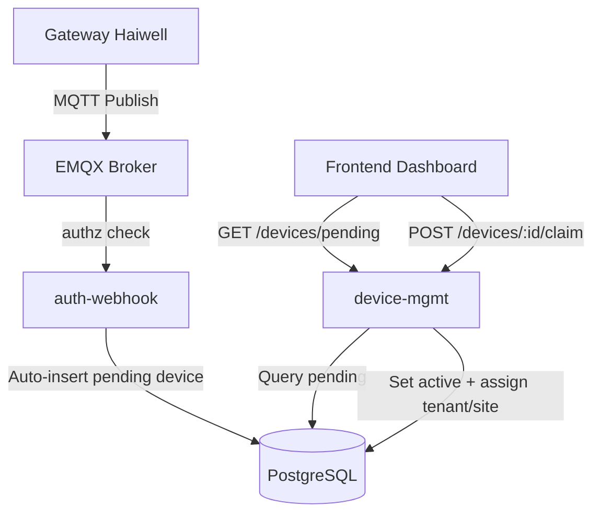

# Device Auto-Detection & Inbox Claim Implementation Plan

> **For agentic workers:** REQUIRED SUB-SKILL: Use superpowers:subagent-driven-development to implement this plan task-by-task. Steps use checkbox (`- [ ]`) syntax for tracking.

**Goal:** Mengizinkan gateway mem-publish device baru secara instan (status pending) dan memunculkan dialog claim di dashboard bagi Superadmin (pilih tenant & lokasi) dan Tenant User (pilih lokasi).

**Architecture:**
- **auth-webhook**: Ketika gateway sah mem-publish `data/.../<target_key>`, jika target belum ada di DB, buatkan record device baru dengan `registration_status = 'pending'`, lalu kembalikan `allow`.
- **device-mgmt**: Menyediakan endpoint `GET /devices/pending` dan `POST /devices/{id}/claim` untuk mengaktifkan dan mengalokasikan tenant & site.
- **frontend**: Komponen `DeviceClaimDialog` di Dashboard layout yang mengecek pending device saat user login dan menampilkan dialog klaim yang disesuaikan dengan role.

**Architecture Diagram:**

**Tech Stack:** FastAPI, SQLAlchemy, PostgreSQL, Next.js 14, TailwindCSS, shadcn/ui.

**Spec:** [2026-10-26-device-auto-detection-inbox-design.md](file:///e:/Project/iiot_multisite/docs/superpowers/specs/2026-10-26-device-auto-detection-inbox-design.md)

## Global Constraints
- Jangan menghapus atau mengubah tabel eksisting; gunakan migrasi non-breaking (kolom `registration_status VARCHAR(32) DEFAULT 'active' NOT NULL`).
- Tenant isolation harus terjaga: Tenant Admin tidak boleh melihat atau mengklaim pending device milik tenant lain.
- TDD diutamakan untuk setiap endpoint baru di `auth-webhook` dan `device-mgmt`.

---

### Task 1: Database Migration & Model Update (PostgreSQL)

**Files:**
- Modify: `services/device-mgmt/app/models.py`
- Modify: `services/auth-webhook/app/models.py`
- Create: `services/device-mgmt/alembic/versions/add_registration_status_to_devices.py` (atau SQL migration script)

- [ ] **Step 1: Update models.py di device-mgmt dan auth-webhook**
Tambahkan field `registration_status = mapped_column(String(32), default="active", nullable=False)`.

- [ ] **Step 2: Buat skrip migrasi SQL / Alembic**
Tambahkan `ALTER TABLE devices ADD COLUMN IF NOT EXISTS registration_status VARCHAR(32) DEFAULT 'active' NOT NULL;`.

- [ ] **Step 3: Jalankan migrasi di database lokal dan verifikasi schema**

---

### Task 2: Auto-Detection di Auth-Webhook

**Files:**
- Modify: `services/auth-webhook/app/lookup.py`
- Modify: `services/auth-webhook/app/acl.py`
- Test: `services/auth-webhook/tests/test_authz.py`

- [ ] **Step 1: Buat fungsi `auto_register_pending_device(db, gateway_identity, target_key)`**
Jika target_key belum ada, lakukan insert ke `devices` dengan:
`name=f"New Device ({target_key})"`, `registration_status="pending"`, `tenant_id=gateway_identity.tenant_id`, `site_id=gateway_identity.site_id`.

- [ ] **Step 2: Update acl.py**
Jika gateway mem-publish ke `data/.../<target_key>`, panggil `auto_register_pending_device` dan kembalikan `True` (`allow`).

- [ ] **Step 3: Tambahkan unit test di test_authz.py**
Uji skenario: gateway mem-publish device baru -> return allow -> device tercatat di DB dengan status pending.

---

### Task 3: Pending Devices & Claim Endpoints di Device-Mgmt

**Files:**
- Modify: `services/device-mgmt/app/schemas.py`
- Modify: `services/device-mgmt/app/routers/devices.py`
- Test: `services/device-mgmt/tests/test_devices_claim.py`

- [ ] **Step 1: Definisikan schema `DeviceClaimRequest` dan `PendingDeviceOut`**
- [ ] **Step 2: Implementasikan `GET /devices/pending`**
Filter berdasarkan role: Superadmin melihat semua pending, Tenant admin hanya melihat pending di tenant-nya.
- [ ] **Step 3: Implementasikan `POST /devices/{id}/claim`**
Superadmin bisa update `tenant_id`, `site_id`, `name`. Tenant admin hanya bisa update `site_id`, `name`. Ubah `registration_status = "active"`.
- [ ] **Step 4: Tulis unit test untuk verifikasi isolasi role dan klaim device**

---

### Task 4: Frontend DeviceClaimDialog & Global Inbox Listener

**Files:**
- Create: `services/frontend/components/devices/device-claim-dialog.tsx`
- Modify: `services/frontend/app/(dashboard)/layout.tsx` (atau navbar notification)
- Modify: `services/frontend/lib/api.ts`

- [ ] **Step 1: Tambahkan API caller `fetchPendingDevices` dan `claimDevice`**
- [ ] **Step 2: Buat komponen UI `DeviceClaimDialog`**
  - Dropdown Tenant (hanya tampil jika user adalah Superadmin).
  - Dropdown Site (lokasi penempatan).
  - Input Nama Device.
  - Tombol "Klaim & Aktifkan Device".
- [ ] **Step 3: Integrasikan ke Dashboard shell**
Cek pending device saat pertama kali halaman dimuat, munculkan pop-up modal jika ada device yang belum diklaim.
