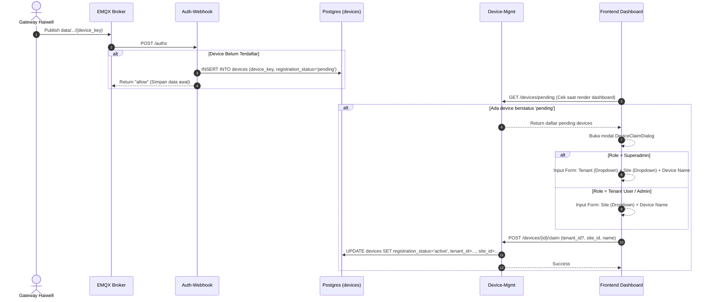

# Device Auto-Detection & Inbox Claim Specification

## 1. Overview & Problem Statement
Saat ini, gateway Haiwell mengirimkan data untuk unit sensor (misalnya `CAN_PoC`, `G001`) yang belum terdaftar di database. Karena aturan ACL menolak topic yang tidak terdaftar, gateway gagal mengirim data dan terus melakukan reconnect berulang.
Fitur ini mengotomasi penanganan device baru:
1. Menerima sementara data dari device yang dipublish oleh gateway sah (`registration_status = 'pending'`).
2. Menampilkan dialog konfirmasi (Inbox) ketika user membuka Web Dashboard:
   - Jika **Superadmin**: Ditanya **Milik Tenant Siapa?** dan **Lokasi Site Mana?**.
   - Jika **User Tenant**: Ditanya **Lokasi Site Mana?** (Tenant terkunci ke tenant user).
3. Setelah diklaim, status device berubah menjadi `active` dan siap dipantau penuh.

## 2. Architecture & Data Flow

## 3. Database Schema Changes
Tabel `devices` di Postgres:
- Menambahkan kolom `registration_status VARCHAR(32) DEFAULT 'active' NOT NULL` (nilai: `'active'`, `'pending'`).
- Saat device baru masuk dari gateway:
  - `tenant_id` dan `site_id` diisi sementara dengan tenant & site milik gateway pem-publish.
  - `registration_status = 'pending'`.
  - `name = 'Unassigned Device (' || device_key || ')'`.

## 4. Backend Endpoints (`device-mgmt`)
- `GET /devices/pending`:
  - Superadmin: Mengambil semua device dengan `registration_status = 'pending'`.
  - Tenant Admin: Mengambil device pending yang terdeteksi di bawah tenant-nya.
- `POST /devices/{device_id}/claim`:
  - Body: `{ "tenant_id": UUID (opsional untuk tenant admin), "site_id": UUID, "name": str }`
  - Memperbarui `name`, `tenant_id`, `site_id`, dan `registration_status = 'active'`.

## 5. Frontend UI (`services/frontend`)
- Komponen `DeviceClaimDialog`:
  - Mengambil daftar pending devices saat dashboard dimuat.
  - Menampilkan modal jika terdapat device pending.
  - Superadmin memilih Tenant & Site tujuan.
  - Tenant Admin hanya memilih Site tujuan.
